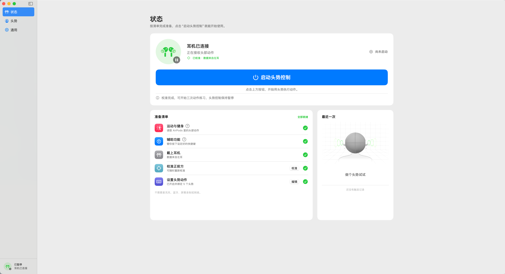
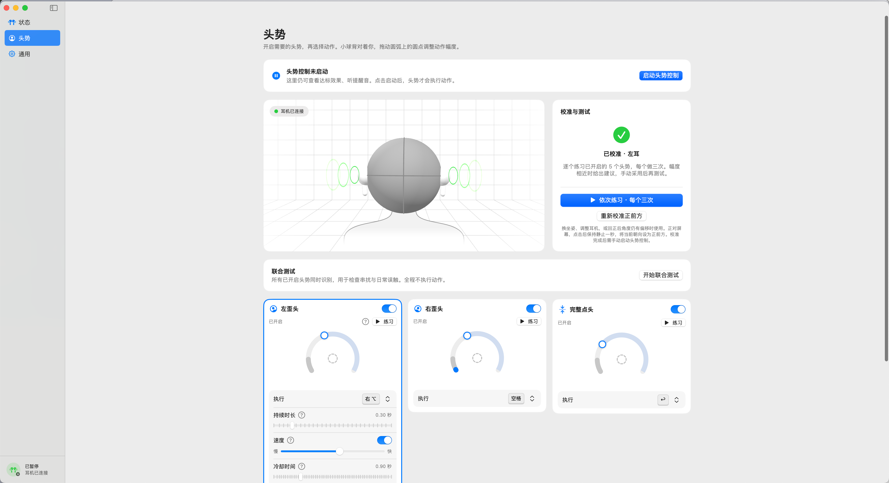

# 头势控制 · HeadControl

**戴上 AirPods，用歪头、转头、点头和摇头控制 Mac。**

边吃饭边看视频，满手是油，又想继续和 AI 聊天？我给自己写了这个免费开源的小工具：把头势绑定到快捷键或应用，就能暂停视频、触发输入法的语音输入、切换应用，再点头发送消息。

[下载 Apple Silicon 版](https://github.com/knockkeykey/HeadControl/releases/latest) · [使用方法](#开始使用) · [源码构建](#构建与测试) · [MIT 许可](LICENSE)

## 看看它的样子

状态页把耳机连接、权限、校准和启动入口放在一起，准备好后点击“启动头势控制”。



在头势页选择动作、拖动圆弧调整幅度，还可以逐项练习和联合测试。



## 可以怎么用

下面是一组“看视频时和 AI 聊天”的配置示例，按自己的习惯修改即可。

| 头势 | 绑定动作 | 用途 |
| --- | --- | --- |
| 右歪头 | 空格 | 播放或暂停当前视频 |
| 左歪头 | 输入法的语音输入快捷键，比如右 Option | 开始或结束语音输入 |
| 完整点头 | Return | 发送消息 |
| 向左转头 | 切换到应用，比如 ChatGPT | 打开 AI 应用 |
| 向右转头 | 切换到上一个应用 | 返回刚才的视频应用 |

视频播放器、输入法和聊天应用需要先配置好对应快捷键。语音识别与文字整理由输入法完成；本工具只负责点按快捷键或切换应用。Return 是发送还是换行，取决于聊天应用的设置；它不会判断语音是否录完或消息是否已经发出。

绑定全局生效，也可以用来控制其他支持快捷键的应用。切换应用按应用进行，同一浏览器里的不同标签页需要另外配置快捷键。

## 支持的功能

- 六种头势：左歪头、右歪头、完整点头、向左转头、向右转头、完整摇头，每种都能单独开关。
- 每种头势可选择点按快捷键、切换到指定应用、切换到上一个应用、暂停头势控制或不操作；快捷键区分左右修饰键。
- 手动调整动作幅度、持续时长、速度条件和冷却时间；点头、摇头还可调整完成时限与回位范围。
- 每种头势可设置不同的提醒音或静音，识别到头势就播放反馈；也可打开不抢输入焦点的悬浮状态条。
- 逐项练习，每个头势做三次，再按需手动采用建议；联合测试可检查多个头势之间的串扰和日常误触，测试不执行绑定动作。
- 菜单栏控制、浅色与深色外观，以及可关闭的走动自动暂停。

默认只开启左右歪头和完整点头：左歪头绑定右 Option，点头绑定 Return，其余绑定为“不操作”。所有速度条件默认关闭，应用启动时保持暂停。截图和上表展示的是自定义配置。

## 下载与安装

要求 **Apple Silicon Mac、macOS 15.3 或更新版本，以及 AirPods Pro 2**。其他耳机型号的兼容性尚未验证；本次发行只提供 ARM64 版本。

1. 到 [Releases](https://github.com/knockkeykey/HeadControl/releases/latest) 下载 `.dmg`，打开后将 `HeadControl.app` 拖入“应用程序”；也可以解压 `.zip` 后自行移入。
2. 打开“头势控制”，连接并戴好耳机。
3. 按应用提示，在系统设置中允许“运动与健身”和“辅助功能／事件发送”。

发行包使用 Developer ID 签名，尚未经过 Apple 公证，macOS 可能阻止首次打开。确认下载来源后，可在“系统设置 → 隐私与安全性”查看系统提供的“仍要打开”选项；受管理的 Mac 请遵循管理员策略。

## 开始使用

1. 在“状态”页确认准备清单已就绪，点击“校准”，正对屏幕保持静止一秒。
2. 在“头势”页开启需要的头势，为它选择快捷键或应用。目标应用未运行时会启动，已运行时切到前台。
3. 先做逐项练习，再用联合测试观察日常动作是否误触；建议参数需要手动采用。
4. 点击“启动头势控制”，切到要操作的应用。可通过菜单栏或悬浮条随时暂停。

容易误触时，可以增大动作幅度、延长持续时长或增加冷却时间；觉得动作太累时，可以适当减小幅度。速度条件需要手动开启，用来区分慢慢移动和干脆利落的动作。

持续歪头不会连续触发，动作收回并经过冷却后才能再次触发。耳机断连、数据中断、重新校准、锁屏或睡眠会暂停控制，恢复后需要按提示校准并手动启动。换坐姿或调整耳机后也可以重新校准正前方。

未启动控制时，在已连接并校准的“状态”或“头势”页可以预览识别和提醒音，不执行绑定动作；关闭、隐藏或最小化设置窗口后停止这类预览。

## 权限与隐私

头势识别通过 Apple 公开的 Core Motion 接口读取耳机运动数据，在本机处理，不连接服务器，不读取或保存输入文字，也不采集音频。本工具无需麦克风、屏幕录制或额外的蓝牙权限；输入法自身的语音输入可能需要麦克风和网络权限。

配置保存在 `~/Library/Application Support/com.keyknock.HeadControl/configuration.json`，包含头势参数、快捷键、提示音和绑定应用的位置等设置。

## 构建与测试

需要完整 Xcode 和 Python 3。项目使用 SwiftUI、AppKit 和 Core Motion，无第三方运行时依赖。

```sh
git clone https://github.com/knockkeykey/HeadControl.git
cd HeadControl
./scripts/test.sh
# 本机开发使用临时签名，无需作者的签名证书
./scripts/build.sh CODE_SIGN_IDENTITY=- DEVELOPMENT_TEAM=
open build/HeadControl.app
```

也可以用 Xcode 打开 `HeadControl.xcodeproj`，选择 HeadControl scheme，并在签名设置中使用自己的团队。默认构建脚本保留维护者的 Developer ID 配置，命令行参数可以覆盖；脚本只为当前命令指定 Xcode，不更改全局 `xcode-select`。

```sh
# 应用切换路由检查，不实际切换应用
./scripts/test-application-controller.sh
# 真实应用切换探针，会打开独立测试窗口
./scripts/test-application-switching.sh
# 界面夹具，不修改用户配置
./scripts/test-interface.sh
# 声音播放与恢复探针，会播放提醒音
./scripts/test-sound-feedback.sh
# 后台发键探针，需要单独授予 Debug 应用事件发送权限
./scripts/test-key-delivery.sh
```

- `Core`：配置迁移、头势识别、动作路由和自动化测试。
- `HeadControl/Platform`：耳机采集、按键发送、应用切换、声音和悬浮条。
- `HeadControl/Views`：原生设置与头势练习界面。
- [VALIDATION.md](VALIDATION.md)：开发期间的技术检查记录；构建和探针结果不代表每台设备的实际佩戴效果。

## 开源许可与致谢

由深键制作，采用 [MIT License](LICENSE)，可以使用、修改和分发，也欢迎提交 Issue 或 Pull Request。

运动采集与坐标约定参考了 HeadOrbit，第三方 MIT 许可保留在 [ThirdPartyNotices/HeadOrbit-LICENSE.txt](ThirdPartyNotices/HeadOrbit-LICENSE.txt)，应用内也包含归属声明。
